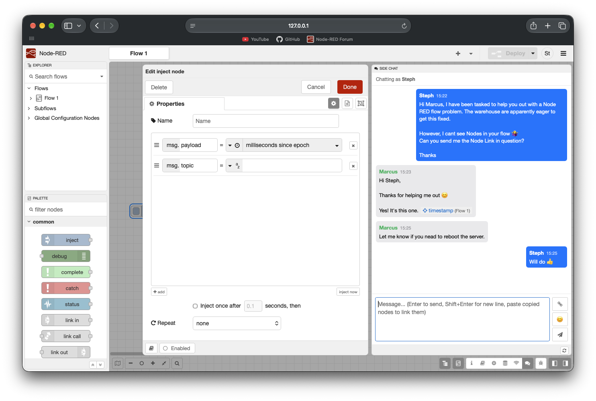

# node-red-sidechat

A chat for the Node-RED editor, in the right-hand sidebar. Everyone logged in to the same Node-RED can talk to each other while they work. Links in the chat take everyone straight to a node.

## Features

- **Team chat inside the editor.** Messages appear for everyone straight away. There's no extra server or service to set up.
- **Real usernames.** Each message shows the name the person logged in to Node-RED with. Nobody can post as someone else.
- **Node links.** Select one or more nodes and drop a link into your message. Clicking the link switches to that flow, highlights the nodes and selects them.
- **@mentions.** Type `@name` to get someone's attention. They get a pop-up notification even if they're on a different sidebar tab.
- **Emoji picker.** It has over 1,600 emoji with search, categories and a recently used list.
- **Message history.** History is saved on the server, so it survives restarts.
- **Admin tools.** Admins can clear the whole chat with a single command.
- **Clear layout.** Your messages are on the right in blue and everyone else's are on the left in grey, like a phone's messaging app.
- **Image support.** Your messages can include an image that gets attached and viewed by the recipients.



## Requirements

- Node-RED 4.0 or newer
- Node.js 18 or newer
- Optional but recommended: editor login (`adminAuth`) switched on, so each person shows under their own username. Without it, the chat still works but everyone appears as **anonymous**. See [Setting up logins](#setting-up-logins).

## Installing

### From the editor

1. Click the **☰ menu** at the top-right of the Node-RED editor and choose **Manage palette**.
2. Open the **Install** tab at the top of the panel.
3. Search for `@marcus-j-davies/node-red-sidechat` and click **Install**.
4. Reload the editor page in your browser.

### From the command line

```bash
cd ~/.node-red
npm install @marcus-j-davies/node-red-sidechat
```

Then restart Node-RED.

## Opening the chat

In the right-hand sidebar, click the small **▾** arrow at the top-right, next to the tab icons, and choose **Side Chat**. You can also click the 💬 speech-bubbles icon among the sidebar tabs.

The line at the top of the chat shows who you're chatting as.

## Using the chat

| To do this | Do this |
|---|---|
| Send a message | Type in the box at the bottom and press **Enter** |
| Start a new line | Press **Shift + Enter** |
| Link to nodes | Select one or more nodes in the workspace, then click the **🔗 link button** at the bottom-right of the chat |
| Add an emoji | Click the **😊 button** at the bottom-right of the chat, then search or browse and click an emoji |
| Mention someone | Type `@` followed by their username, e.g. `@alice` |
| Delete your message | Hover over your message and click the **bin icon** at its top-right |
| Reload the chat | Click the **refresh icon** at the top of the chat tab |

### Node links

A node link shows the node's name and its flow, for example *Read sensor (Kitchen)*. Anyone who clicks it is taken to that flow, and the node is highlighted and selected. A link to several nodes selects them all.

Other people only see nodes that have been **deployed**. If you link a node you haven't deployed yet, it shows as crossed out ("node no longer exists") for everyone else until you deploy.

### @mentions

- Notifications only pop up when someone mentions **you**. Ordinary messages don't notify anyone.
- Mentions are not case-sensitive, so `@Alice` and `@alice` both work.
- Only the whole username matches, so `@al` won't notify `alice`.
- Usernames with spaces can't be mentioned. Use names like `alice`, `bob.smith` or `bob_smith`.

## Setting up logins

The chat takes each person's name from their Node-RED login. Without logins, everyone shows as **anonymous**, and the chat says so at the top.


## Permissions

| Permission | What it allows |
|---|---|
| `sidechat.read` | Read the chat |
| `sidechat.write` | Post messages and delete your own |
| `*` (full access) | Everything, including admin commands |

Node-RED's general permissions include these automatically:

- `"read"` includes `sidechat.read`.
- `"write"` includes `sidechat.write`.
- A user with `["read", "write"]` can use the chat fully.
- A read-only user (`"read"`) can follow the chat but not post.

## Admin commands

Users with full access (`*`, `sidechat.admin`) can type these into the message box:

| Command | What it does |
|---|---|
| `admin:clear` | Deletes all messages for everyone, straight away |

Commands are never posted as chat messages. If anyone else types one, the server refuses it and they see an error.

## Notes

- Messages are stored in a JSON file in your Node-RED user directory, usually `~/.node-red`.
- On Windows, country flag emoji show as two letters (e.g. "GB") instead of pictures. This is a Windows limitation, not the plugin's.

## Licence

 MIT License

Copyright (c) 2026 Marcus Davies

Permission is hereby granted, free of charge, to any person obtaining a copy
of this software and associated documentation files (the "Software"), to deal
in the Software without restriction, including without limitation the rights
to use, copy, modify, merge, publish, distribute, sublicense, and/or sell
copies of the Software, and to permit persons to whom the Software is
furnished to do so, subject to the following conditions:

The above copyright notice and this permission notice shall be included in all
copies or substantial portions of the Software.

THE SOFTWARE IS PROVIDED "AS IS", WITHOUT WARRANTY OF ANY KIND, EXPRESS OR
IMPLIED, INCLUDING BUT NOT LIMITED TO THE WARRANTIES OF MERCHANTABILITY,
FITNESS FOR A PARTICULAR PURPOSE AND NONINFRINGEMENT. IN NO EVENT SHALL THE
AUTHORS OR COPYRIGHT HOLDERS BE LIABLE FOR ANY CLAIM, DAMAGES OR OTHER
LIABILITY, WHETHER IN AN ACTION OF CONTRACT, TORT OR OTHERWISE, ARISING FROM,
OUT OF OR IN CONNECTION WITH THE SOFTWARE OR THE USE OR OTHER DEALINGS IN THE
SOFTWARE.
